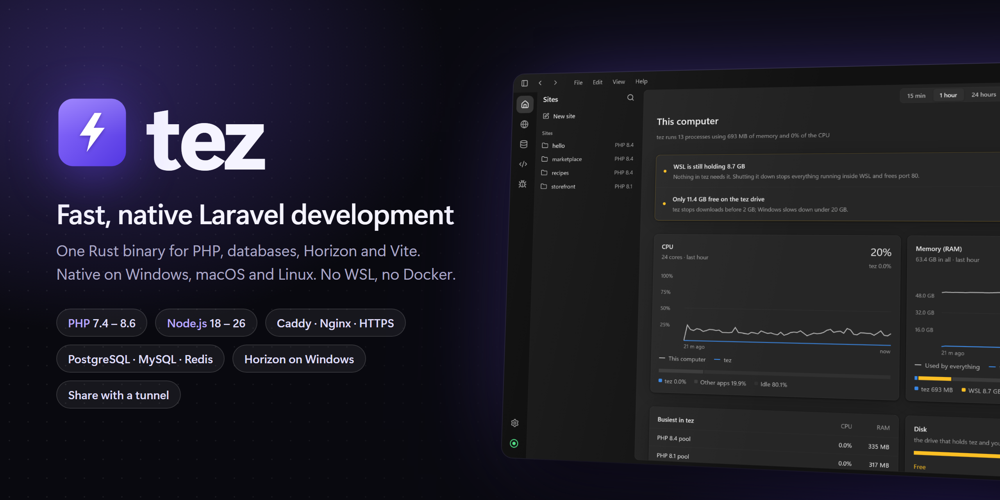
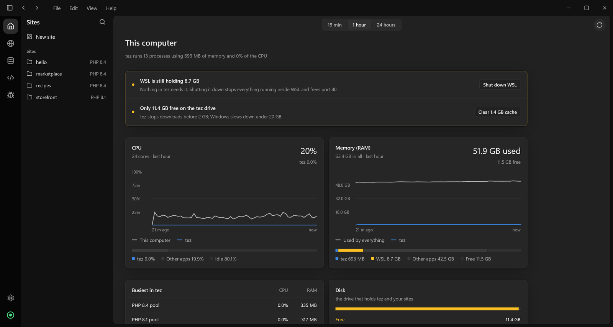
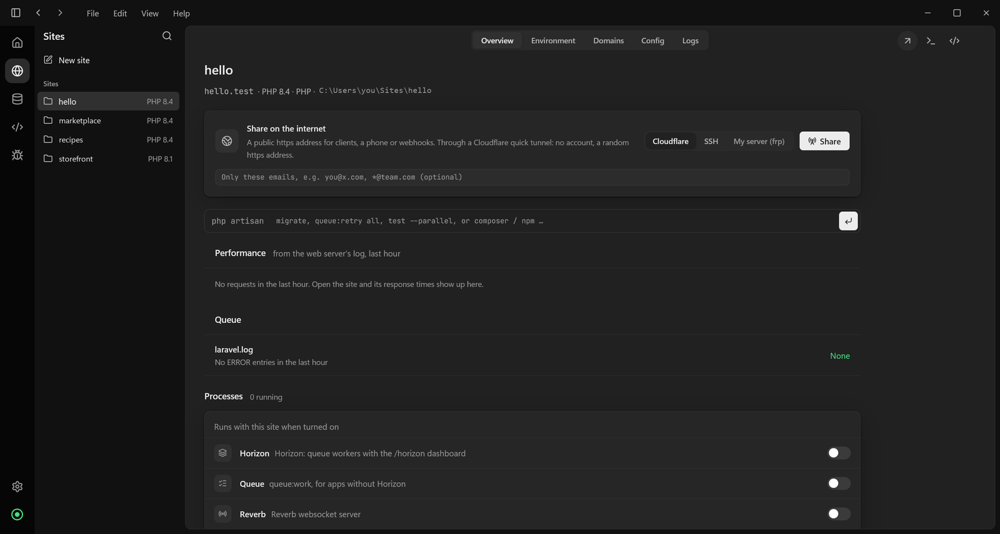
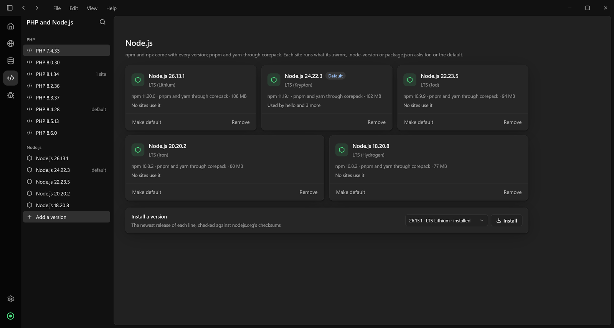
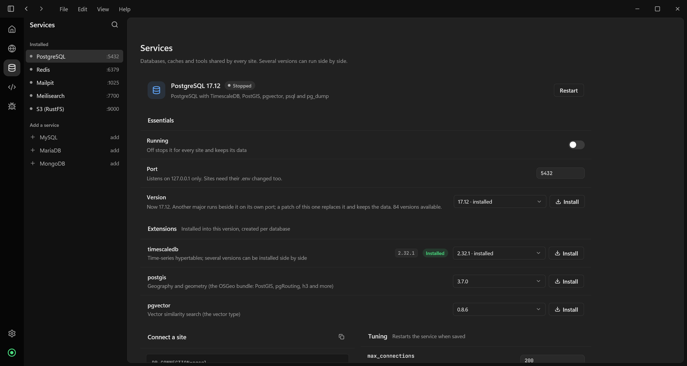

<p align="center">
  
</p>

<p align="center">
  <a href="https://github.com/boparaiamrit/tez/releases/latest"></a>
  <a href="https://github.com/boparaiamrit/tez/actions/workflows/ci.yml"></a>
  
  
  <a href="LICENSE"></a>
</p>

<p align="center">
  <a href="#install">Install</a> ·
  <a href="#quick-start">Quick start</a> ·
  <a href="#the-desktop-app">Desktop app</a> ·
  <a href="#nodejs">Node.js</a> ·
  <a href="#share-a-site-on-the-internet">Sharing</a> ·
  <a href="#what-runs">What runs</a>
</p>

---

**tez** (Punjabi and Hindi for "fast") is one Rust program that installs and runs everything a
Laravel project needs, as native processes: every PHP version, every Node.js LTS, a web server with
local HTTPS, PostgreSQL with TimescaleDB, MySQL, MariaDB, MongoDB, Redis, Meilisearch, S3 storage and
a mail catcher. It also runs each project's Horizon, Reverb, Vite and scheduler, and can put a site
on the internet through a tunnel.

You drive it from a native desktop app with a tray icon, a web dashboard, or the `tez` command
line. It covers the feature set of Laravel Herd and Herd Pro, and adds Horizon running natively on
Windows.

## Highlights

- **No WSL, no Docker, no Sail.** Projects live on your own disk and run natively, with no virtual
  machine eating memory and no slow file bridge.
- **Every PHP version, picked per site.** PHP 7.4 to 8.6 side by side. `php` and `composer` in your
  terminal use the version of the site you are in.
- **Every Node.js LTS, picked per folder.** Node.js 18 to 26. `node`, `npm`, `npx`, `pnpm` and
  `yarn` follow `.nvmrc`, `.node-version` or `package.json` engines.
- **Horizon on Windows.** Horizon needs `pcntl` and `posix`, which Windows PHP lacks. tez fills the
  gap, so `/horizon`, `terminate`, `pause` and `continue` work as on Linux.
- **Local HTTPS, Caddy or Nginx.** Every folder is a site at `https://<folder>.test` and
  `https://<folder>.localhost`, signed by tez's own certificate authority.
- **Databases and services, several versions at once.** PostgreSQL 14 to 18 with TimescaleDB,
  PostGIS and pgvector; MySQL; MariaDB; MongoDB; Redis; Meilisearch; Mailpit; S3 through RustFS.
- **Share a site in one click.** A public HTTPS address through a Cloudflare quick tunnel (no
  account), an SSH tunnel, or your own frp server.
- **Fast by default.** OPcache for web and CLI, a large realpath cache and Filament's icon cache.
  A typical login page answers in about 80 to 110 ms over HTTPS on Windows, with Defender still
  scanning.

## Screenshots

<table>
  <tr>
    <td width="50%"><br><sub><b>Home.</b> Is my machine OK? Problems with their fix, memory and CPU over time.</sub></td>
    <td width="50%"><br><sub><b>A site.</b> Response times, errors, queue, Horizon, Reverb and Vite, sharing.</sub></td>
  </tr>
  <tr>
    <td width="50%"><br><sub><b>PHP and Node.js.</b> Every version side by side, with the sites that use each.</sub></td>
    <td width="50%"><br><sub><b>Services.</b> Versions, extensions, ports and tuning per service.</sub></td>
  </tr>
</table>

## Why

Laravel on Windows usually means WSL and Sail: a virtual machine that holds many gigabytes of
memory, slow file access across the Windows/Linux boundary, and memory running out when several
tools work at once. Herd for Windows avoids WSL, but every request starts Laravel from scratch
through `php-cgi`, and Microsoft Defender scans every file it touches.

tez attacks those costs one by one:

| Cost on Windows | What tez does |
| --- | --- |
| Every request re-reads thousands of files | OPcache on for web **and CLI**, a 16 MB realpath cache, an on-disk opcode cache for cold starts |
| Filament's Blade Icons lists thousands of SVGs per request | `icons:cache` runs automatically (`tez adopt` and `tez up`): a Filament page went from ~800 ms to ~100 ms |
| `artisan`, Horizon and queue workers compile everything per process | CLI OPcache: `artisan route:list` 3.6 s → 0.8 s, each worker 88 MB → 12 MB |
| Defender scans every PHP file read | `tez doctor --fix` excludes the tez folder and your site folders (one admin prompt) |
| WSL's memory and its file bridge | Projects live on NTFS and run natively; WSL can be shut down |
| A full SSD | tez refuses to download or copy when the disk would drop under 2 GB free |

## Install

Download the package for your system from the
[latest release](https://github.com/boparaiamrit/tez/releases/latest):

| System | Installer | Or unpack it yourself |
| --- | --- | --- |
| Windows (x64) | `tez-<version>-windows-x64-setup.exe` | `tez-<version>-windows-x64.zip` |
| macOS (Apple silicon) | `tez-<version>-macos-arm64.dmg` | `tez-<version>-macos-arm64-cli.tar.gz` (command line only) |
| Ubuntu 24.04+, Debian 13+ (x64) | `tez-<version>-linux-x64.deb` | `tez-<version>-linux-x64.tar.gz` |
| Fedora 40+, RHEL 10+ (x64) | `tez-<version>-linux-x64.rpm` | `tez-<version>-linux-x64.tar.gz` |

Each release is built, smoke-tested and packaged by GitHub Actions on its own operating system,
and every installer is installed, run and removed there before it is published.

**Windows.** Run the setup. It needs no administrator rights: it installs for your account, sets
up PHP, the web server and services, adds tez to the Start menu and starts it. Uninstall it from
Settings → Apps; your databases and settings stay in `%USERPROFILE%\.tez`. The installer is not
code-signed yet, so SmartScreen may warn the first time: choose **More info**, then **Run anyway**.

**Linux.**

```bash
sudo apt install ./tez-<version>-linux-x64.deb     # Ubuntu, Debian
sudo dnf install ./tez-<version>-linux-x64.rpm     # Fedora, RHEL
tez install                                        # then, as yourself: PHP, the web server, services
```

**macOS.** Open the `.dmg` and drag tez to Applications. It is not notarised yet: the first time,
right-click it and choose Open. Then, in a terminal:
`/Applications/Tez.app/Contents/MacOS/tez install` (after that, `tez` is on your PATH).

`tez install --all` downloads PHP 7.4 to 8.6, the Caddy web server, PostgreSQL 17 with
TimescaleDB, Redis, Mailpit, Meilisearch, RustFS and, if you have no Node.js yet, the newest LTS
into `~/.tez`. Plain `tez install` (what the Windows setup runs) installs the default PHP plus
PostgreSQL, Redis and Mailpit. Either way it puts tez's `php`, `composer`, `node` and `npm` first
in every new terminal, so open a new terminal afterwards.

<details>
<summary>Build from source</summary>

```powershell
cargo build --release --workspace     # tez and tez-app (Windows needs the VS 2022 C++ tools)
.\target\release\tez.exe install --all
```

</details>

## Quick start

Once, after installing:

```powershell
tez start          # everything in the background, plus the tray icon
tez trust          # trust local HTTPS and add hosts entries (one admin prompt)
tez doctor --fix   # Defender exclusions for tez and your sites (one admin prompt)
```

Every day:

```powershell
tez open                         # the desktop app (or click the tray icon)
tez status                       # processes, memory, sites
cd ~\Sites\myapp; tez up         # Horizon or queue, Reverb, Vite and the scheduler for this project
tez logs myapp/horizon -f
tez share                        # a public https address for the site you are in
```

Any folder in `~/Sites` is a site at `https://<folder>.test`, and always at
`https://<folder>.localhost` too (browsers resolve `.localhost` with no hosts entry).

### Moving a project off WSL

```powershell
tez import /home/me/code/myapp           # copies it out of WSL (measures first; skips vendor,
cd ~\Sites\myapp                         #   node_modules, caches and folders over 1 GB)
tez setup                                # composer install, .env, key, database, migrations, npm install
tez up
```

`tez setup` runs `tez adopt`, which points the `.env` at tez's services (`DB_HOST=127.0.0.1`,
`REDIS_HOST`, mail, Meilisearch, S3). It keeps the original as `.env.sail`, creates the database
and role from the `.env`, and serves every `*_DOMAIN` host for multi-domain apps. For a Docker
database you want to keep, use `tez db pull <container> <db>`.

### Cloning from GitHub

The desktop app's **New site from GitHub** page (or `tez clone owner/repo`) lists the repositories
of every account signed in to the GitHub CLI and its organisations. It clones through the matching
SSH alias from `~/.ssh/config` (for example `github.com-work`) or through gh over HTTPS, then runs
`tez setup`. Any git URL works too. Tokens stay in gh's store; tez never keeps them.

## The desktop app

`tez-app` is a native window built with [GPUI Kit](https://gpui-kit.com), plus a tray icon (the
menu bar on macOS, an AppIndicator on Linux). It draws its own title bar on Windows and macOS, with
File, Edit, View and Help menus, back and forward, and the window buttons. Closing the window leaves
tez in the tray.

The window has an icon rail (Home, Sites, Services, PHP and Node.js, Debug), a list for the current
section and an inset panel. Each page answers one question first:

- **Home: is my machine OK, and are my sites fast?** Problems that need you, each with its fix;
  memory over 15 minutes, an hour or a day, split into PHP pools, site processes, services and the
  web server; the whole machine and the disk; a card per site with requests per minute, p95 response
  time and server errors; a card per service.
- **A site: is it fast and healthy?** p50 and p95 response times, the slowest routes, the latest
  server errors and ERROR entries in laravel.log, all read from the web server's own log with no code
  in your app. Queue throughput and the slowest jobs, read from Horizon's output. Horizon, Reverb,
  Vite and the scheduler as cards with their memory, CPU and restarts. A box to run artisan,
  composer or npm in the site. Tabs for the environment (secrets masked), domains, config files and
  logs.
- **Services, PHP and Node.js, Dumps, Mail, Logs,** and **Settings** in a sheet.

Switches react the moment you click: the card stays where it is, a spinner shows the work, and a
toast says when it is done. Typed changes save themselves shortly after you stop typing. Secrets
(APP_KEY, passwords, API keys) are masked, have a show toggle and their own Save button.

The same settings are in the web dashboard at `http://127.0.0.1:7979`, which also has logs, dumps
and a config file editor.

## Node.js

tez installs official Node.js builds from nodejs.org, each checked against its SHA-256 checksums,
and runs the right one for each folder:

```powershell
tez node install 18 20 22 24 26    # or `lts`, or an exact version such as 22.11.0
tez node default 24                # what runs where nothing asks for a version
tez node which                     # the version for this folder, and why
```

- A site runs the version pinned for it in tez, else what its `.nvmrc`, `.node-version` or
  `package.json` engines asks for, else the default. Vite and npm jobs started by tez use it too.
- `node`, `npm`, `npx`, `pnpm`, `yarn` and `corepack` in your terminal are tez's, and pick the
  version for the folder you are in. Until tez has a Node.js of its own, they run the one you had.
- pnpm and yarn work on every version through corepack. Node.js 25 and later ship without it, so
  tez adds it when it installs them. When the newest pnpm cannot run on an older Node.js, that
  version uses the pnpm its own corepack shipped with.
- `npm install -g` puts tools in one shared folder (`~/.tez/npm`) that is on PATH, so they work
  whichever version runs.

On Windows the computer's PATH comes before yours, so a Node.js installed for the whole computer
would win. tez therefore puts its folder first as each terminal starts: PowerShell 7 and Windows
PowerShell from their profile, cmd from its AutoRun, Git Bash from its start-up file. Each line it
adds ends with `# tez`.

## Share a site on the internet

```powershell
tez share                              # the site you are in, through a Cloudflare quick tunnel
tez share myapp --via ssh              # localhost.run, or your own sish server
tez share myapp --allow you@team.com   # only these emails, with a one-time PIN (Cloudflare)
tez share list
tez share stop myapp
```

| Way | Account needed | Address |
| --- | --- | --- |
| Cloudflare quick tunnel (default) | none | a random `*.trycloudflare.com` |
| SSH (`tez share setup ssh <host>`) | none for localhost.run | `*.lhr.life`, or your own sish domain |
| frp (`tez share setup frp <server> --domain <d>`) | your own frp server | `<site>.<your domain>` |

The site page in the app has the same controls. Every share gets its own web server block that
tells PHP the request is HTTPS and keeps the public host name, so Laravel builds correct `https`
links behind the tunnel. tez downloads `cloudflared` and `frpc` from their official GitHub releases
the first time and checks them against the published digests.

## Web server: Caddy or Nginx

Caddy serves the sites by default. To use Nginx instead, pick it under Settings, **Web server and
ports**, or run `tez web use nginx` (`tez web use caddy` to go back). The switch replaces only the
web server process: the same host names, ports and HTTPS, and the PHP pools keep running. Both
servers use tez's own certificate authority in `config/ca`. For Nginx, tez signs one certificate
covering every site's names and renews it when the sites change. `tez web` shows which server runs
and where its config is.

## Removing a site

```powershell
tez site rm myapp                    # stop serving it; the folder stays
tez site rm myapp --files            # also move the folder to the Recycle Bin (type the name to confirm)
tez site rm myapp --database         # also drop its database on tez's own server (type the name)
tez site hidden                      # sites removed from tez whose folders remain
tez site unhide myapp                # serve one again
```

The site's processes stop, its tez settings go, and the web server stops serving it. `--files`
moves the folder to the Recycle Bin on Windows, or the Trash on macOS and Linux: tez never deletes a
folder outright, and refuses when the move would not be recoverable (a network drive, a Recycle Bin
that is off or too small, a Sites folder, your home folder, a drive or a link). `--database` drops
the database named in the site's `.env`, and its `_testing` twin, only on a PostgreSQL, MySQL or
MariaDB that tez runs here.

## What runs

| Part | Source | Notes |
| --- | --- | --- |
| PHP 7.4–8.6 | windows.php.net official builds, SHA-256 checked | redis, mongodb and xdebug from PECL; `tez ext install <any>` for the rest |
| Node.js 18–26 | nodejs.org official builds, SHA-256 checked | npm and npx with every version; pnpm and yarn through corepack |
| Web server | Caddy 2.11 (default) or Nginx 1.30 | local HTTPS, HTTP/2, compression, websockets |
| PHP pools | `php-cgi` per version | 6 workers each, restarted if they exit |
| PostgreSQL 14–18 | EnterpriseDB builds | TimescaleDB (several versions side by side), PostGIS, pgvector, psql, pg_dump |
| MySQL 8.0/8.4, MariaDB 10.11–12.3 | official zips | root, no password, 127.0.0.1 |
| MongoDB 6.0–8.2 | fastdl.mongodb.org | |
| Redis 8 | redis-windows builds | |
| Meilisearch, Mailpit | official releases | Mailpit's inbox at http://127.0.0.1:8025 |
| S3 | RustFS | MinIO stopped publishing binaries in 2025; key `tez`, secret `tez-secret` |
| Tunnels | cloudflared, OpenSSH, frpc | downloaded on first use and checked against the release digests |

Several versions of a service can run at once: `tez service install postgres 16` adds `postgres@16`
on its own port beside the default PostgreSQL 17.

## macOS and Linux

The same `tez` binary runs on macOS (Apple silicon and Intel) and Linux (x86_64 and arm64). Linux
needs glibc 2.39 or newer (Ubuntu 24.04, Debian 13, Fedora 40, RHEL 10 and later). What differs from Windows:

| Part | macOS / Linux source | Notes |
| --- | --- | --- |
| PHP 8.0–8.5 | Apple silicon: tez's own static builds ([tez-php](https://github.com/boparaiamrit/tez-php)); elsewhere, static-php-cli's "bulk" builds | One `php` and `php-fpm` per version with ~60 extensions built in. PECL add-ons, Xdebug and PHP 7.4 are Windows-only for now |
| PHP 8.6 | not published yet as a static build | Sites that need 8.6 run on Windows for now |
| PHP pools | `php-fpm`, one master per version | `php_workers` children each |
| Web server | Caddy 2.11, or Nginx 1.30 from jirutka/nginx-binaries | Nginx on macOS needs Homebrew's PCRE2 (`brew install pcre2`) |
| PostgreSQL 14–18 | theseus-rs/postgresql-binaries | TimescaleDB, PostGIS and pgvector are Windows-only for now |
| Redis | compiled from the source release with `make` | Needs the Xcode Command Line Tools, or `build-essential` on Linux |
| MariaDB | official bintar | Linux x86_64 only |
| MongoDB, MySQL, Mailpit, Meilisearch, RustFS | official builds per OS | RustFS: no Intel Mac build |

On macOS, `tez adopt` and `tez setup` set `DB_HOST` to PostgreSQL's socket folder (`~/.tez/run`),
because static-php-cli's PostgreSQL driver cannot open TCP connections there. TablePlus and psql can
use `127.0.0.1`.

Processes run in their own process groups; the daemon ends them all on `tez stop`, SIGTERM or
SIGINT. `tez trust` and `tez hosts` use `sudo`. Start at sign-in is a LaunchAgent on macOS and an
XDG autostart entry on Linux. On Linux, ports 80 and 443 need root, so tez serves on 8088 and 8443.

For CI and scripts: `tez install --php 8.4 --services redis,postgres` (or `--services none`)
installs without prompts, `tez start` works without a display, and `tez status --json` prints the
daemon's state.

## Horizon on Windows

Windows PHP has no `pcntl` or `posix` extension, and Horizon needs both. tez loads a small PHP
layer (`lib/php/horizon-windows.php`) into `artisan horizon*` processes only. That layer:

- defines the `SIG*` constants and the `pcntl_*` / `posix_*` functions Horizon calls
- delivers signals between Horizon's processes through mailbox files, picked up by the master and
  supervisors on their `sleep(1)` loop, so `horizon:terminate`, `pause` and `continue` work
- checks process liveness through kernel32 (FFI)

The command shims also make Horizon's `exec @php ...` command lines work in cmd.exe. Everything
Horizon writes to Redis is Horizon's own code, so the `/horizon` dashboard works as on Linux.
Composer skips the `ext-pcntl`/`ext-posix` platform check through the `composer` shim.

## Security

- Every service and the dashboard listen on 127.0.0.1 only.
- The API accepts only its own host names (no DNS rebinding) and refuses changes without the
  `X-Tez` header, which web pages on other sites cannot send.
- Dumps render in sandboxed frames with scripts off.
- Local PostgreSQL trusts connections from 127.0.0.1, so project passwords are not checked
  locally; they are kept in `.env` for parity with production.
- Every process tez starts runs in a Job Object on Windows, so nothing outlives tez.
- `tez trust` installs tez's own certificate authority (`config/ca/root.crt`) into the system's
  trusted roots. Its key never leaves your computer.
- PHP, Node.js, cloudflared and frpc downloads are checked against their published SHA-256 sums
  or GitHub release digests before they are used.

## Layout

```text
src/            the tez binary: CLI, daemon, API, PHP, Node.js, services, sites, web server, tunnels
app/            tez-app: the GPUI Kit desktop app and tray icon
assets/         the web dashboard and the PHP files tez loads into PHP
~/.tez/
  bin/          tez, tez-app, and the php, composer, node, npm, npx, pnpm, yarn shims
  php/<x.y>/    PHP versions          node/<x.y.z>/   Node.js versions
  npm/          npm's global tools    services/       service binaries
  data/         databases and stores  config/         tez.json, web server config, certificates
  logs/         one log per process   cache/          downloads
```

## Not done yet

- Typesense has no Windows build, so it is not offered.
- Pausing Horizon from the dashboard restarts supervisors rather than pausing them in place.
- Port 80 falls back to 8088 while another program holds it.

## License

[MIT](LICENSE) © Amritpal Singh
